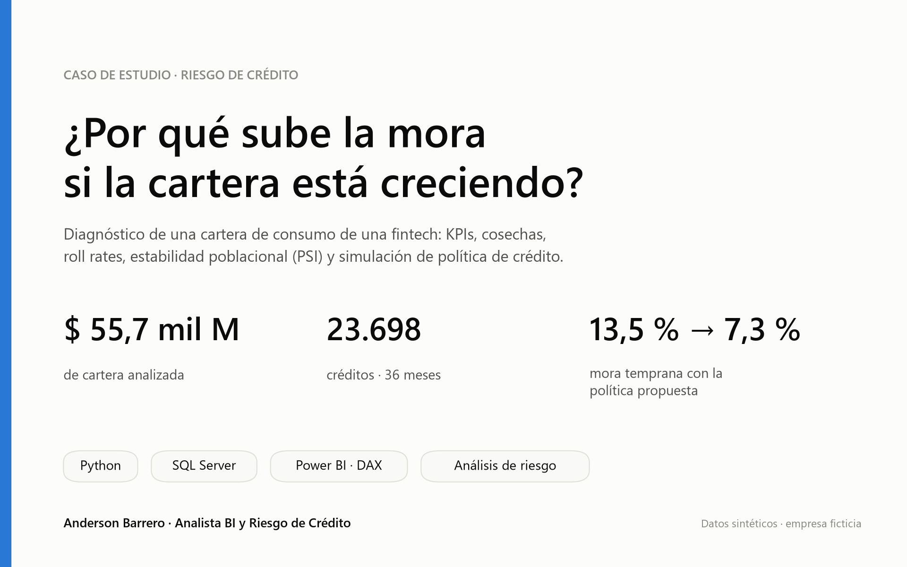
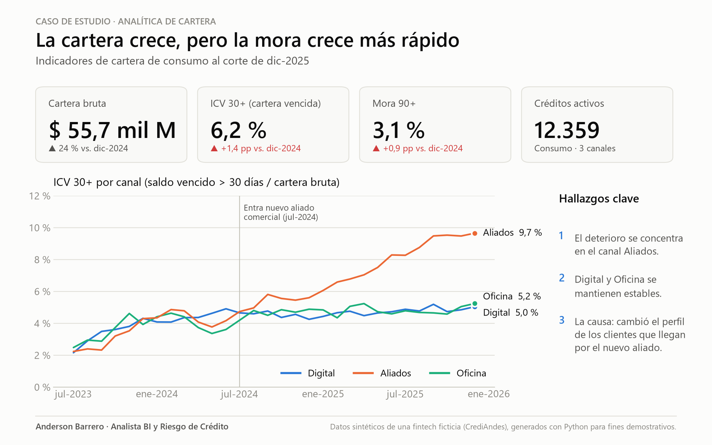
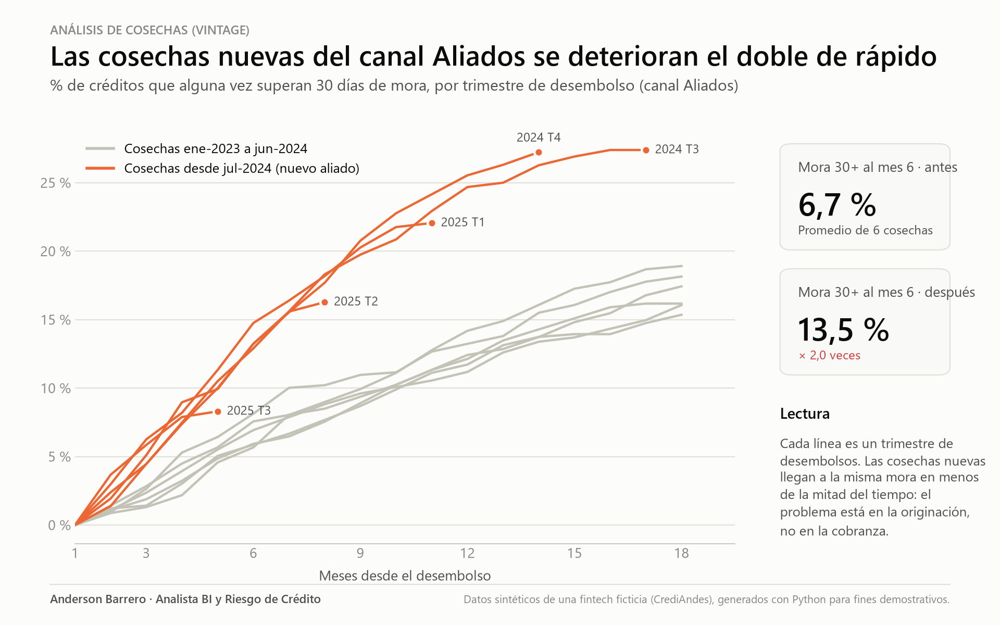
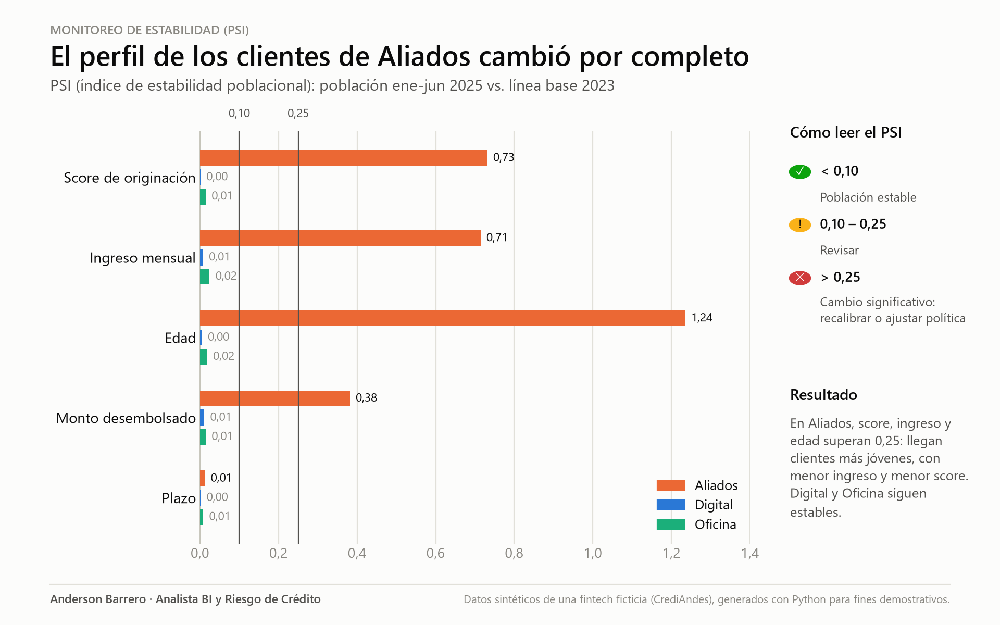
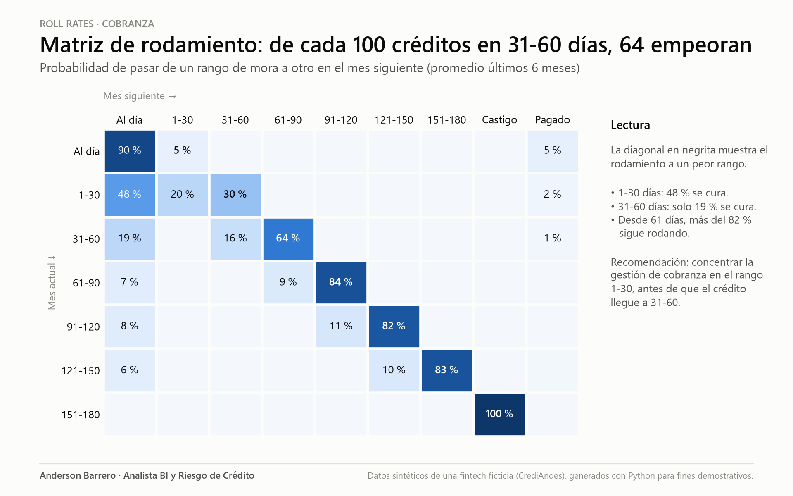
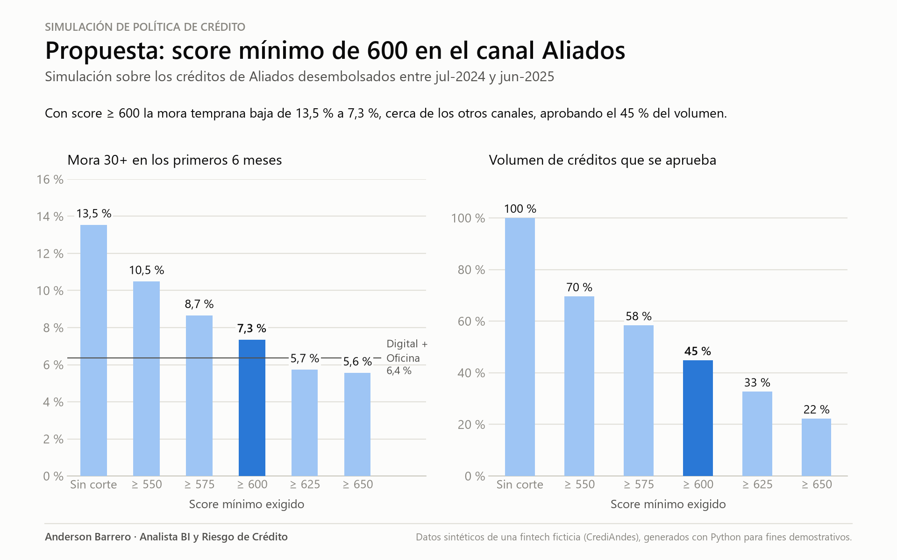

# ¿Por qué sube la mora si la cartera está creciendo?
### Caso de estudio: diagnóstico de una cartera de crédito de consumo



> **Nota:** todos los datos son **sintéticos**. Los generé con Python para una fintech ficticia ("CrediAndes"). No provienen de ninguna empresa real.

## El problema
Una fintech de crédito de consumo creció un 24 % en cartera durante 2025, pero su indicador de cartera vencida (ICV 30+) pasó de 4,7 % a 6,2 %. La gerencia necesitaba saber **dónde está el deterioro, por qué ocurre y qué hacer**.

## Enfoque
| Paso | Pregunta | Técnica |
|---|---|---|
| 1. KPIs | ¿Cuánto y dónde sube la mora? | ICV 30+ y mora 90+ por canal y mes |
| 2. Cosechas | ¿Es un problema de originación o de cobranza? | Curvas vintage por trimestre de desembolso |
| 3. Roll rates | ¿En qué rango de mora se pierde el crédito? | Matriz de transición mensual |
| 4. PSI | ¿Cambió el perfil de los clientes? | Índice de estabilidad poblacional por variable |
| 5. Simulación | ¿Qué política corrige el problema y cuánto cuesta? | Puntos de corte de score: mora vs. volumen |

## Hallazgos
1. **El deterioro se concentra en el canal Aliados** (ICV 30+ de 9,7 %, frente a ~5 % en Digital y Oficina).
2. **Las cosechas desde julio de 2024 se deterioran el doble de rápido:** 13,5 % de mora 30+ al mes 6, frente a 6,7 % antes.
3. **Cambió la población:** el PSI de score (0,73), ingreso (0,71) y edad (1,24) en Aliados supera con creces el umbral de 0,25. El nuevo aliado comercial trae clientes más jóvenes, con menor ingreso y menor score.
4. **Cobranza:** solo el 19 % de los créditos en 31-60 días se cura; la gestión temprana (1-30 días) es la de mayor impacto.

## Recomendación
**Exigir un score mínimo de 600 en el canal Aliados.** La mora temprana bajaría de 13,5 % a 7,3 %, cerca del nivel de los demás canales (6,4 %), aprobando el 45 % del volumen actual de ese canal. Un corte de 575 es una alternativa más conservadora en volumen (58 % aprobado, 8,7 % de mora).







## Tablero de Power BI
- `powerbi/CarteraCrediAndes.pbix`: tablero de 5 páginas (Resumen, Cosechas, Roll rates, PSI y Simulación) con datos cargados.
- `powerbi/CarteraCrediAndes/`: el mismo tablero en formato de proyecto (PBIP), apto para control de versiones con Git.
- Los CSV se leen desde el parámetro `RutaDatos`. Si mueves la carpeta: Transformar datos > Administrar parámetros > RutaDatos.

## Estructura del proyecto
```
datos/                creditos.csv, desempeno_mensual.csv y resultados/ (tablas del análisis)
scripts/
  generar_datos.py    simulación de la cartera (cadena de Markov de días de mora)
  analisis_cartera.py KPIs, cosechas, roll rates, PSI y simulación de política
  graficos.py         imágenes del caso
sql/consultas_cartera.sql   las mismas métricas en SQL Server (T-SQL)
powerbi/medidas_dax.md      modelo estrella y medidas DAX para el tablero
imagenes/                   gráficos del caso (1920x1200)
```

## Cómo ejecutarlo
```bash
pip install pandas numpy matplotlib
python scripts/generar_datos.py
python scripts/analisis_cartera.py
python scripts/graficos.py
```

## Herramientas
Python (pandas, NumPy, Matplotlib) · SQL Server · Power BI (DAX, Power Query) · Analítica de riesgo de crédito

---
**Anderson Barrero Saenz** · Analista BI y Riesgo de Crédito · [LinkedIn](https://www.linkedin.com/in/anderson-barrero-saenz/)
